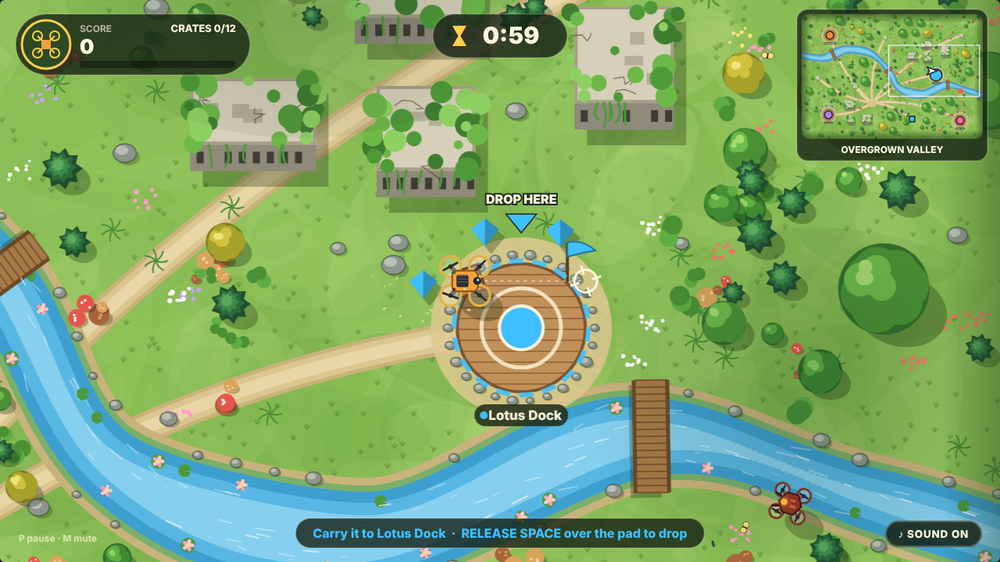
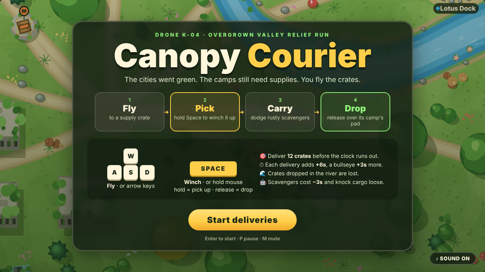

# 🚁 Canopy Courier

**A top-down drone pick-and-drop delivery game for the browser.**
The cities went green. Vines swallowed the towers and the river runs wild, but the camps in the Overgrown Valley still need supplies. You fly **K-04**, a rotor-guarded courier drone. Winch up supply crates, carry them across the valley, and drop them on the landing pad of the right camp before time runs out.



---

## ▶️ Quick start

Requires **Node.js 18+**.

```bash
npm install
npm run dev
```

Then open the URL Vite prints (usually **http://localhost:5173**) and click **Start deliveries**.

| Command | What it does |
| --- | --- |
| `npm run dev` | Start the dev server with hot reload |
| `npm run build` | Type-check (`tsc`) and build a static site into `dist/` |
| `npm run preview` | Serve the production build locally |
| `npm run typecheck` | Type-check only |

The `dist/` build is plain static files, so it runs from any web host. A GitHub Actions workflow (`.github/workflows/deploy.yml`) publishes it to **GitHub Pages** on every push to `main`. To turn it on, go to **Settings → Pages → Source: GitHub Actions**.

---

## 🎮 How to play

### The core loop: Pick and Drop

| 1. **Fly** | 2. **Pick** | 3. **Carry** | 4. **Drop** |
| --- | --- | --- | --- |
| Follow the gold arrows to a supply crate waiting at a stone cache. | **Hold Space** (or the mouse button) near it. The winch hooks it and it swings below you on a rope. | The crate's coloured tag and pin show which camp it belongs to. An arrow guides you there. Scavenger drones try to ram you. | **Release Space** over that camp's landing pad. A reticle shows where the crate will land. |

### Controls

| Input | Action |
| --- | --- |
| **W A S D** / **Arrow keys** | Fly (thrust with momentum and drag) |
| **Space** / **hold left mouse** | Hold to winch a crate up · release to drop it |
| **P** / **Esc** | Pause |
| **M** | Mute / unmute |
| **Enter** | Start / instant rematch |

### Rules: how you win and lose

- **Win:** deliver **12 crates** before the clock hits zero. Leftover seconds become bonus points.
- **Lose:** the clock runs out.
- You start with **60 s**. Each delivery adds **+6 s**, and a bullseye adds **+3 s** more.
- A crate dropped in the **river** is lost (bridges are safe). A crate dropped on the **wrong camp** or on open ground stays put, so you can pick it up again.
- **Scavenger drones** (rusty red) wander the valley. When you're carrying cargo nearby, they lock on (🔴 eye + siren) and chase you. A ram costs **−3 s** and knocks your crate loose. Loaded, you're slower than an empty drone but still faster than a scavenger, so you can outfly them. A new scavenger joins every 4 deliveries (max 3).
- **Giant trees** and **ruined buildings** are tall enough to crash into. Fly around them.

### Scoring

| Event | Points |
| --- | --- |
| Delivery | **+100** |
| Bullseye (lands in the pad's coloured centre) | **+50** |
| Express (delivered within 7 s of pickup) | **+25** |
| Victory time bonus | **+10 per second left** |

The results screen gives a 0–3 ★ rank (*Grounded → Rookie → Trusted → Legendary Courier*) and keeps your personal best in `localStorage`.

---

## ✨ Features

- **Feel-first drone physics.** The drone has inertia, exponential drag, a speed cap and heading that follows your velocity. A loaded drone is heavier and slower.
- **Rope physics.** The carried crate hangs on a damped spring, so it swings and lags behind you. When you release it, it keeps its momentum and falls for 0.45 s, so you have to *lead* your drops. The landing reticle uses the same formula as the simulation, so what you see is where the crate lands. It turns gold for a bullseye, green when on target and red over water.
- **A hand-painted world, all made in code.** A seeded generator builds the 2560×1760 valley: a Catmull-Rom river with lily pads, lotus flowers and bridges, dirt paths, forests of round trees and pines, vine-covered ruins, mushroom rings, abandoned cars and four camps with tents and waving flags. It is baked once into an offscreen canvas, so each frame only copies what's on screen.
- **A living valley.** Cloud shadows drift across the map, sunlight glints on the river, butterflies scatter from your rotor wash, and leaves blow around under the drone.
- **Game juice.** Confetti on delivery, splashes and ripples, leaf bursts when you clip a tree, sparks on impacts, screen shake, pop-in animations and floating score text.
- **Navigation aids.** A minimap with live crate, scavenger and camp markers, arrows at the screen edge with distances, a pulsing *DROP HERE* marker and contextual hints.
- **Complete lifecycle.** Title screen (with an autopilot flyover behind it) → 3-2-1 countdown → play → victory or time-out results → instant rematch. Pausing, auto-pause when the tab is hidden, and a mute setting that persists between visits.

## 🔊 Sound design

There are **no audio files**. Everything is synthesised live with the Web Audio API in [`src/audio.ts`](src/audio.ts):

| Sound | How it's made |
| --- | --- |
| Rotor hum | 3 detuned oscillators + band-passed noise with a 34 Hz "chop" tremolo. Pitch and brightness follow thrust, and it drops a little under load |
| Music | Lookahead-scheduled C-major pentatonic melody over a I–vi–IV–V bass line with a soft pad and shaker |
| Ambience | Looping low-passed wind whose volume slowly rises and falls, plus random birdsong chirps panned across the stereo field |
| Winch pick-up | Latch clunk + rising servo whine + confirmation ping |
| Drop | Latch click + falling air whoosh |
| Crate landing | Low wooden thud |
| Delivery | Marimba arpeggio + camp cheer. A bullseye adds a bell sparkle, and a time-bonus chime follows |
| River splash | Filtered noise splash + bubble blips |
| Tree / ruin hit | Leafy rustle / dull stone knock |
| Scavenger | Two-tone siren when it locks on. Harsh buzz + metal clank on a ram |
| Wrong camp, countdown, low-time clock ticks, victory fanfare, defeat tune, UI click | Short synth cues |

---

## 🧱 Tech and project structure

- **Vite + vanilla TypeScript (strict) + HTML5 Canvas 2D**
- **Zero runtime dependencies.** The only dev dependencies are `typescript` and `vite`.
- **Zero external assets.** All art and audio are generated in code.

```
canopy-courier/
├── index.html            # Canvas + title / results screens (DOM overlays)
├── src/
│   ├── main.ts           # Entry: wires game ↔ DOM screens, shortcuts, frame loop
│   ├── game.ts           # State machine, drone/crate/scavenger simulation, world rendering
│   ├── world.ts          # Seeded map layout (camps, caches, river, obstacles) + painter
│   ├── hud.ts            # Score/clock panels, minimap, off-screen arrows
│   ├── fx.ts             # Particles, ripples, floating text, banners, screen shake
│   ├── audio.ts          # Procedural music, ambience and SFX (Web Audio API)
│   ├── input.ts          # Keyboard + mouse state
│   ├── config.ts         # Every tunable number (speeds, timers, points, palette)
│   └── style.css         # Overlay / menu styling
├── docs/                 # Screenshots used in this README
├── vite.config.ts        # Relative base so the build works on GitHub Pages
└── .github/workflows/    # CI: build + deploy to GitHub Pages
```

### Where each mechanic lives

| Mechanic | Code |
| --- | --- |
| Pick (winch) | `Game.updatePlaying` → `Game.pick` |
| Carry (rope swing) | `Game.updateCrates` (state `'carried'`) |
| Drop and landing rules | `Game.drop` → `Game.updateCrates` (state `'falling'`) → `Game.land` → `deliver` / `loseCrate` |
| Landing prediction | `DROP_REACH` + `Game.drawReticle` |
| Win / lose | `Game.deliver` (quota reached) · `Game.updatePlaying` (clock ≤ 0) → `Game.endMatch` |
| Scavenger AI | `Game.updateScavs`, `Game.scavHit` |
| Difficulty ramp | More scavengers and faster chases as `delivered` grows (`SCAV` in `config.ts`) |

To tweak the balance, change the numbers in [`src/config.ts`](src/config.ts). Gameplay code never hard-codes them.

## 🌐 Browser support

Any recent Chrome, Edge, Firefox or Safari on desktop. You need a keyboard, or a keyboard plus mouse. Sound starts after your first click or key press because of browser autoplay rules.



## License

[MIT](LICENSE)
